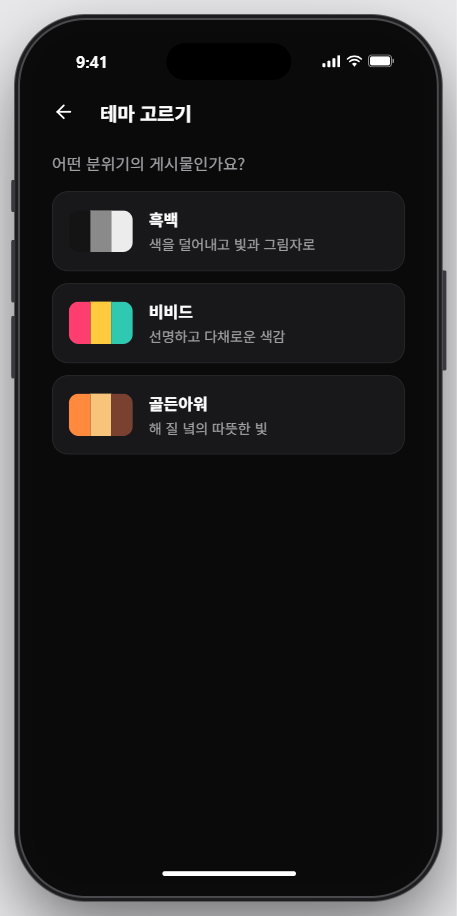
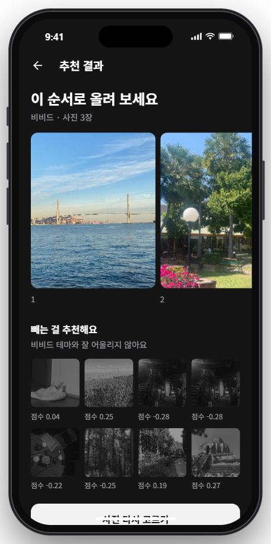
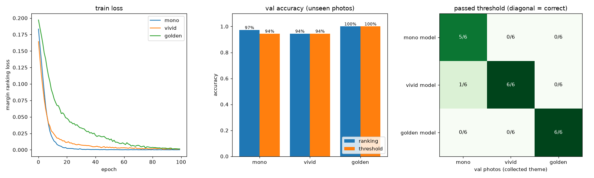
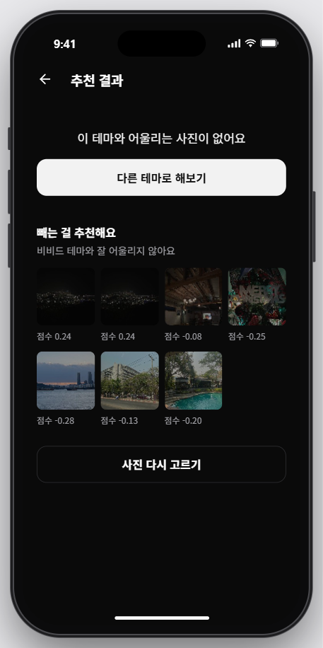

# GridFlow

AI 기반 피드 미적 분석 및 업로드 순서 추천 서비스

사진 묶음과 테마 문장을 입력하면, ① 테마에 안 맞는 사진을 걸러내고 ② 남은 사진들을 서로 잘 어울리는 순서로 배치해 추천하는 것을 목표로 하는 개인 프로젝트입니다.

## 📌 현재 상태

AI 파이프라인(`Ai/`) 설계·검증 단계가 진행 중이며, `Backend/`는 FastAPI 서버와 배포용 Dockerfile까지 만들었고, `Frontend/`는 화면을 만들고 있습니다.

| 단계 | 상태 | 설명 |
|---|---|---|
| 색감 피처 추출 | ✅ | OpenCV 기반 색감 피처(hue/saturation/value 등 10차원) |
| CLIP 콜드스타트 baseline | ✅ | 사진-테마 텍스트 유사도(1차원) |
| 테마 적합도 스코어링 (`ScoringMLP`) | ✅ | 테마마다 모델을 따로 학습(흑백·비비드·골든아워), 부적합 사진 제외 "제안" + 유지 사진 점수화 |
| 전이 비용 학습 (`TransitionCostModel`) | ✅ | 사진 두 장의 어울림을 학습하는 페어와이즈 모델, 체크포인트 저장됨 |
| 사진 N장 정렬 알고리즘 | ⚠️ 재구현 필요 | 학습된 비용 모델을 실제로 그룹 정렬에 쓰는 조합 최적화 로직 미구현 |
| 학습 데이터 수집 | ✅ | Unsplash API 기반 준자동 수집(`Ai/collect_unsplash_data.py`) |
| 백엔드(API 서버) | ❌ 미착수 | 프레임워크/구조 미정 |
| 프론트엔드 | ❌ 미착수 | 미정 |
| 실사용자 피드백 루프 | ❌ 미착수 | 드래그 재정렬 등으로 실 데이터 수집 예정 |

### 🚧 화면 미리보기 (작업 중)

모바일 웹 화면을 만들고 있습니다. 아래는 지금까지 만든 화면 중 두 개입니다.

<table>
  <tr>
    <th width="50%">테마 고르기</th>
    <th width="50%">추천 결과</th>
  </tr>
  <tr>
    <td align="center"></td>
    <td align="center"></td>
  </tr>
  <tr>
    <td valign="top">흑백 · 비비드 · 골든아워 중에서 게시물 분위기를 고릅니다.</td>
    <td valign="top">테마에 맞는 사진은 올리기 좋은 순서로 보여주고, 잘 안 맞는 사진은 점수와 함께 "빼는 걸 추천해요"로 따로 보여줍니다. 빼는 건 제안일 뿐이고, 최종 결정은 사용자가 합니다.</td>
  </tr>
</table>

## 🧭 아키텍처

전체 파이프라인은 두 계층으로 나뉩니다.

**Layer 1 · 테마 적합도 스코어링** — "이 사진이 이 테마에 얼마나 맞는가"
```
사진 + 테마 문장
  → CLIP 유사도(1d) + 색감 피처(10d) = 11차원 입력 벡터
  → 고른 테마 전용 ScoringMLP → 적합도 점수
  → 테마별 기준값보다 낮으면 "제외 제안" (자동 삭제 아님, 최종 결정은 사용자)
```

**Layer 2 · 전이 비용 배치** — "남은 사진들을 어떤 순서로 배치할까"
```
사진 두 장의 11차원 피처
  → TransitionCostModel(|A - B|) → 전이 비용 점수 (낮을수록 자연스러움)
  → (재구현 필요) 그룹 내 정렬 + 그룹 간 정렬 → 최종 순서
```

두 모델 모두 절대적인 정답 라벨이 아니라 **상대 비교(pairwise ranking)** 로 학습합니다. 사용자에게 "이 사진 0.7점"을 받을 방법은 없지만 "이 사진 유지, 저 사진 제외"나 "이 두 사진은 잘 어울린다/안 어울린다" 같은 상대적 피드백은 자연스럽게 쌓이기 때문입니다.

### 📈 테마 적합도 모델 학습 결과

처음에는 모델 하나를 흑백 사진 데이터로만 학습해 모든 테마에 썼습니다. 그랬더니 모델이 "색이 없을수록 좋은 사진"만 배워서, 비비드나 골든아워를 골라도 흑백 사진만 통과했습니다([#23](https://github.com/jinohpark371/GridFlow/issues/23)).

지금은 **테마마다 모델을 따로 학습**합니다. 예를 들어 골든아워 모델은 "골든아워로 수집된 사진"이 "다른 테마로 수집된 사진"보다 높은 점수를 받도록, 두 사진을 모두 골든아워 기준으로 채점해 가며 학습합니다. 사진을 지우는 기준값도 모델마다 점수 범위가 달라서 테마별로 따로 정합니다.



| 그래프 | 보는 법 |
|---|---|
| 왼쪽 · train loss | 학습하면서 손실이 0 근처로 떨어지면 학습이 된 것입니다. 골든아워가 가장 천천히 떨어지는데, 셋 중 색만으로 구분하기 가장 어려운 테마이기 때문입니다 |
| 가운데 · val accuracy | 학습에 쓰지 않은 검증 사진 18장으로 잰 정확도입니다. 파랑은 "이 테마 사진이 다른 사진보다 높은 점수를 받은 비율", 주황은 "기준값으로 맞게 가른 비율"입니다 |
| 오른쪽 · passed threshold | 모델(세로)마다 검증 사진(가로, 테마당 6장)이 몇 장 통과했는지입니다. **대각선만 진하면** 테마마다 자기 사진만 통과시킨다는 뜻입니다 |

실제 앱에서 같은 비비드 테마로 분석했을 때의 차이입니다.

<table>
  <tr>
    <th width="50%">수정 전 (흑백 전용 모델 하나)</th>
    <th width="50%">수정 후 (테마별 모델)</th>
  </tr>
  <tr>
    <td align="center"></td>
    <td align="center"></td>
  </tr>
  <tr>
    <td valign="top">비비드를 골랐는데 바다·야경·수영장 같은 컬러 사진까지 전부 "빼는 걸 추천해요"로 가고, "이 테마와 어울리는 사진이 없어요"만 나옵니다.</td>
    <td valign="top">컬러 사진은 올릴 순서로 추천되고, 비비드와 안 맞는 흑백 사진만 "빼는 걸 추천해요"로 갑니다.</td>
  </tr>
</table>

학습 데이터는 Unsplash에서 테마당 30장씩 모은 90장입니다(학습 24장, 검증 6장). 검증 사진이 적어서 정확도가 한두 장 차이로 크게 움직일 수 있습니다. `python Ai/evaluate_mlp.py`를 실행하면 다시 학습하고 이 그래프를 새로 그립니다. 자세한 분석과 설계 결정은 [`docs/ai/Mlp_scoring.md`](docs/ai/Mlp_scoring.md)에 있습니다.

## 🛠 기술 스택

- **모델**: PyTorch, Hugging Face `transformers`(CLIP `openai/clip-vit-base-patch32`)
- **이미지 처리**: Pillow, OpenCV
- **데이터 수집**: Unsplash API, `httpx`
- **테스트**: `pytest`
- **시각화**: `matplotlib`

## 🚀 시작하기

```bash
# 가상환경 생성 및 활성화
python -m venv .venv
source .venv/Scripts/activate   # Windows Git Bash 기준

# 의존성 설치
pip install -r requirements.txt

# 테스트 실행 (네트워크 필요한 통합 테스트는 기본 제외)
python -m pytest

# 개별 모듈 실행 예시
python Ai/mlp.py samples/photo1.JPG "미니멀한 감성 사진"
```

Unsplash 데이터 수집·재학습 스크립트를 실행하려면 저장소 루트에 `.env` 파일을 만들고 `UNSPLASH_ACCESS_KEY=<발급받은 키>`를 추가해야 합니다.

## 📁 프로젝트 구조

```
Ai/                    AI 파이프라인 (패키지가 아닌 스크립트 스타일)
  clip.py               CLIP 이미지/텍스트 임베딩
  features.py            색감 피처 추출
  mlp.py                 ScoringMLP (테마 적합도)
  transition_cost_model.py  TransitionCostModel (전이 비용, 페어와이즈)
  dataset.py              학습 데이터 로더
  collect_unsplash_data.py  Unsplash 데이터 수집
  checkpoints/             학습된 모델 가중치
  data/                    학습용 라벨/피처 데이터
Backend/                [미정] 아직 비어있음
Frontend/               [미정] 아직 비어있음
docs/ai/                모듈별 설계 결정 문서 (WHY 중심)
tests/ai/                모듈별 단위/통합 테스트
samples/                 개발용 샘플 사진
```

## 📚 문서

- 각 모듈의 설계 결정과 이유는 `docs/ai/<모듈명>.md`에 정리돼 있습니다 (예: [`docs/ai/Mlp_scoring.md`](docs/ai/Mlp_scoring.md), [`docs/ai/Transition_cost_model.md`](docs/ai/Transition_cost_model.md))
- 코딩 에이전트/협업 규칙은 [`AGENTS.md`](AGENTS.md) 참고
